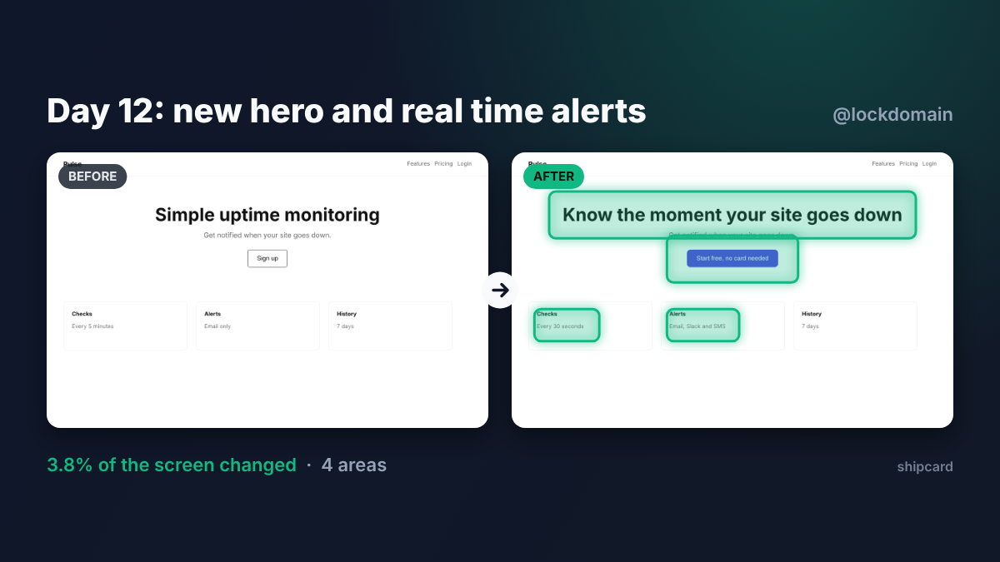

# ShipCard

**Show what you shipped, not what you committed.**

Drop a screenshot of your product from before and one from today. ShipCard finds what changed, highlights it and exports a 1200×675 card that looks sharp in the X timeline.

**[Try it live](https://lockdomain.github.io/shipcard/)**



## Why

Build in public posts about commits ("refactored auth", "fixed bug") are hard to care about. A picture of your product getting better is not. ShipCard turns that into a 20 second habit.

## Features

* Visual diff that finds changed regions and draws them on the After shot
* Headline, handle and five themes
* Download PNG or copy straight to the clipboard
* Paste screenshots with Ctrl+V
* Runs 100% in your browser. Your screenshots never leave your machine
* Zero dependencies, zero build step. Three static files

## How the diff works

Both images are scaled to the same width and compared pixel by pixel. Changed pixels are grouped into 10px cells, nearby cells are merged, and each group becomes a highlighted region. The sensitivity slider sets how big a color change has to be to count.

Tip: take both screenshots at the same window size. If your layout shifts a lot, everything below the shift will be marked as changed.

## Run locally

```
git clone https://github.com/lockdomain/shipcard
cd shipcard
python3 -m http.server
```

Then open http://localhost:8000.

## License

MIT
